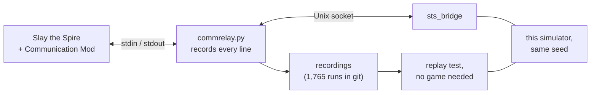

# sts_lightspeed, checked against the real game

A fork of [gamerpuppy/sts_lightspeed](https://github.com/gamerpuppy/sts_lightspeed), the fast C++ simulator of Slay the Spire, changed until it plays like the real game. We played the same seeds in the game and in the simulator, made the same moves in both, compared the whole state after every move, and fixed each difference against the game's own code. It plays all four characters. As each builds by default, it runs 1.3 to 2 times as fast as upstream, and 1.2 to 1.6 times with the same build settings.

**[How to use it](USAGE.md)** · [Every fix, with the seed that found it](https://github.com/latioswang/sts/blob/HEAD/research/realgame/reports/simulator_fixes.md) · [The bridge to the real game](https://github.com/latioswang/sts/tree/HEAD/research/realgame) · [Contributing](#contributing)

| Measure | Result |
|---|---|
| Runs recorded on the real game | 1,765, at every ascension from 0 to 20 |
| Recorded moves replayed against this simulator | 754,533, with the whole game state compared after each |
| Whole runs with no difference, on distinct seeds | Ironclad 422, Silent 248, Defect 249, Watcher 248 |
| Fixes | 219, of which 169 were found by a seed on the real game and 50 by reading the game's code |
| Content exercised on the real game | Every card, relic, potion, monster, power and ascension level met its coverage target; events are at 97% |
| Speed | 1.95x upstream on upstream's own tree search benchmark as each builds by default, and 1.62x with link-time optimisation on both |

## Why

Upstream aims to be exact down to the random number generator, and it is close. But small differences grow over a run. One extra roll on a monster's AI stream shifts every move that monster makes afterwards. An agent trained in a simulator learns the simulator, so its mistakes become the agent's mistakes, and a strategy that wins there can lose in the game.

Some of what the real game showed us:

- Lizard Tail never revived the player: its ready flag started at 0 and was never set.
- Acts 2 and 3 got the wrong encounters and bosses, because the "no repeat of the first strong encounter" rule only existed for act 1.
- Match and Keep was missing from the shrine pool, which changed most shrine rolls.
- A dying Mugger rolls the AI stream (`Mugger.die` calls `playDeathSfx`), so every later move came one roll early.
- Awakened One's Curiosity did nothing. Darkling's Chomp hit once instead of twice. Orrery did nothing, and neither did picking up Old Coin, Necronomicon or Dolly's Mirror.
- Powers, relics and queued cards act in the game's order in many more places: the powers in the status map by priority and then in the order gained, end-of-turn and after-draw relics in the order acquired, and a card's copies straight after it. A few fixed orders are left, listed under the known gaps.

The [fix list](https://github.com/latioswang/sts/blob/HEAD/research/realgame/reports/simulator_fixes.md) has all 219, each with the seed and floor where the game showed it, what the simulator did, what the game does (the method that decides it), and the commit.

## How we checked it

The checking lives in [latioswang/sts](https://github.com/latioswang/sts/tree/HEAD/research/realgame), next to the agent that played the runs.



1. **Mirror mode.** [Communication Mod](https://github.com/ForgottenArbiter/CommunicationMod) lets a program play the real game. The bridge starts the same seed in the game and in the simulator, has the agent choose each move in the simulator, sends the move to the game, and compares the two states: HP, gold, deck, relics, potions, map, rewards, shop, the hand, draw and discard piles in order, the exhaust pile as a multiset, and each monster's HP, block, powers, move and intent damage. A small test mod also reports the state of the game's 12 random streams, so a run stops at the first extra or missing roll and names the stream.
2. **Every difference read against the game's code.** A stop is a bug in the simulator or in the bridge. Each one was traced to the rule in the game's bytecode before it was fixed, and the fix list records that rule in our own words.
3. **Rare content on purpose.** The agent only meets some cards and relics by luck, so the test mod can hand items out at the start of a run and force an encounter. That is how every card, relic and potion got used on the real game, runs reached the Heart in act 4, and every ascension from 0 to 20 was covered. Two audits compared every `ascensionLevel` check in the game's monsters and events with the simulator.
4. **A regression test from real runs.** Every run is recorded. `run_regression.py` plays all 1,765 back through mirror mode with no game running, in a minute or two on 4 cores, and fails if any run gets worse. Every simulator change goes through it.
5. **Code no run had reached.** Replaying the recordings through a coverage build lists the simulator lines no real run has checked. Those were read against the game's code. Some of what turned up was then confirmed with targeted seeds, and the rest is marked "code" in the fix list.

These runs cover the paths our agent plays, not every path, and new seeds still find rare bugs: in the last batch, 8 of 265 new seeds found a difference that needed a fix.

Of the 1,765 recordings, 1,466 replay to the end with no difference. 251 stop early without a verdict: mostly at a Discovery the recording can't check (161), at a move the bridge no longer sends (39), or at a difference in a run whose test scenario had to be rebuilt from what the game showed (34). 48 are known failures with the reason written down: 31 are old recordings of seeds whose later runs got further, 4 are states only a test scenario can make, 8 came from the bridge or the test setup at the time, 1 from BaseMod's fixes, and 4 haven't been looked into.

## Known differences

Some of the game's randomness can't be reproduced from the seed, by any simulator:

- **Discovery** regenerates its three cards on every frame for about a quarter of a second, and each regeneration rolls `cardRandomRng`, so that stream depends on the frame rate until the next floor.
- **The Courier's replacement card** is picked with an unseeded random call.
- **The end-of-turn exhaust order** comes from an unseeded `Collections.shuffle`, so mirror mode compares the exhaust pile as a multiset.
- **Secret Portal** joins act 3's events after 800 seconds of play. The simulator assumes it has.
- **A curse's preview on the transform screen** rolls `cardRng` every 0.1 seconds while the screen is up.

Known gaps, with details in the [fix list](https://github.com/latioswang/sts/blob/HEAD/research/realgame/reports/simulator_fixes.md#known-gaps):

- Silent, Defect and Watcher have had about 270 runs each on the real game, against 953 for Ironclad, so their rarer interactions have had fewer chances to show.
- Stance isn't in Communication Mod's state, so it is only checked indirectly, through damage, energy and intents.
- A potion reward with a full belt stays on screen in the game, where a player could discard a potion and take it. The simulator drops it.
- A few rare interactions aren't fixed yet, such as Rampage under both Double Tap and Duplication, and some orders that are still fixed rather than the game's: The Bomb among end-of-turn powers, and Strength and Dexterity, which sit outside the status map.
- Runs recorded before 2026-11-06 had BaseMod's five gameplay fixes on. Two have shown up: the replay models the one that lifts the potion reward cap, and the one that gives an orb slot is a known failure. The other three haven't been compared.

## What changed from upstream

173 commits on top of upstream, from 2026-11-02 to 2026-11-08:

- **Fidelity:** the 219 fixes above.
- **All four characters.** Upstream has Ironclad. Defect's cards come from [Attemory/sts_lightspeed](https://github.com/Attemory/sts_lightspeed), and Silent's and Watcher's from [hewzhew/SpireSim](https://github.com/hewzhew/SpireSim), with [klottick/spire-gym](https://github.com/klottick/spire-gym) as a second reference (all MIT). Every card was checked against the game's code, which won wherever the sources disagreed, and then played on the real game.
- **Speed.** The action queue holds a function pointer and its captures instead of a `std::function`. Player statuses are a flat table, card piles hold up to 48 cards inline, which cards can be played and which monsters targeted are kept as masks with a branch-free check, and the library and programs build with link-time optimisation. Each change was checked to give identical results: the same agent games at ascensions 0 and 20, a replay of every recording made so far (1,609 to 1,765 as they grew) with the same result for each, and a 3,000-seed differential test of random decks of up to 96 cards across all four characters.
- **Build.** A plain clone builds with CMake 4, with no other repository and no pybind11 needed. See [USAGE.md](USAGE.md).

## Speed

Upstream's own benchmarks, from its `test` program, one thread, on an Apple M3 with Apple clang 21. Each number is the fastest of 10 interleaved rounds (25 for the simple agent), on a machine running other work. The fork plays differently because of the fixes, so runs end on slightly different floors, and the comparison is floors simulated per second.

| Build | Tree search (`agent_mt 1 200 0 5000 120 0`) | Simple agent (`simple_agent_mt 1 100000 5000`) |
|---|---|---|
| Upstream `7476a81`, as it builds (`-O3`) | 237 floors/s, 1.00x | 140,943 floors/s, 1.00x |
| This fork with upstream's flags | 324 floors/s, 1.37x | 164,290 floors/s, 1.17x |
| Upstream with link-time optimisation | 286 floors/s, 1.21x | 151,534 floors/s, 1.08x |
| This fork, as it builds (with link-time optimisation) | 462 floors/s, 1.95x | 178,340 floors/s, 1.27x |

The tree search spends most of its time in combat, where most of the speed work went. On the research agent's own evaluation in [latioswang/sts](https://github.com/latioswang/sts), the speed work cut CPU time at ascension 0 from 22.9 s to 12.4 s, and a second round took off another 7%. [USAGE.md](USAGE.md#benchmarks) has the commands.

## Get started

```bash
git clone --recurse-submodules https://github.com/latioswang/sts_lightspeed.git
cd sts_lightspeed
cmake -S . -B build -DCMAKE_BUILD_TYPE=Release
cmake --build build -j 8
printf 'LIGHTSPEED W 0\n' | ./build/main | head
```

That builds the console game (`main`), the benchmarks and tools (`test`) and the C++ library. [USAGE.md](USAGE.md) covers the Python module, using the library from your own code, checking your changes against the 1,765 real runs, and running against the real game.

## Contributing

Forks and pull requests are welcome, and so are reports of a difference from the game. We would rather the fixes end up in every Slay the Spire simulator than only in this one.

- **Report a difference** in [this repository's issues](https://github.com/latioswang/sts_lightspeed/issues/new/choose). Give the seed text, character, ascension and floor, what the game did and what the simulator did. A save file or a Communication Mod transcript helps most. Build problems and questions go there too. Problems with the bridge, the recordings or the agent go to [latioswang/sts's issues](https://github.com/latioswang/sts/issues).
- **Every change to behaviour needs evidence:** a seed where the real game shows it, or the game method that decides it. Add a row to the fix list in the same words as the others: what the simulator did, what the game does, and why.
- **Run the replay test before and after** (see [USAGE.md](USAGE.md#check-a-change-against-1765-real-runs)). A fix should make runs get further, never shorter.
- **Speed changes must not change results.** Check them with the replay test and the agent games.
- **Don't paste decompiled game code.** Describe the rule in your own words and name the method, as the fix list does.

Good first contributions: a seed of your own that shows a difference, one of the [known gaps](https://github.com/latioswang/sts/blob/HEAD/research/realgame/reports/simulator_fixes.md#known-gaps), Linux and Windows build checks, and more of the game in the Python module.

## Credits and license

MIT, as upstream ([LICENSE.md](LICENSE.md)). The simulator is gamerpuppy's work, and this fork builds on it. The other characters' cards are ported from Attemory, hewzhew and klottick's MIT projects. Three fixes came from [jdc5549/sts_lightspeed](https://github.com/jdc5549/sts_lightspeed)'s list of the bugs it found. The bridge's monster, power and move tables come from [gamerpuppy/sts_lightspeed#3](https://github.com/gamerpuppy/sts_lightspeed/pull/3).

Slay the Spire is made by Mega Crit. This project isn't affiliated with them, and it contains no decompiled game code and none of the game's assets. You need your own copy of the game to run anything against it.

Branches: `master` has everything. Fixes land on `fidelity` first and are merged into `master`.

---

## Upstream's README

For tree search and simulation of the popular rogue-like deckbuilder game Slay The Spire

**Features**
* c++ 17 compiled with gcc
* Standalone
* Designed to be 100% RNG accurate*
* Playable in console
* Speed: 1M random playouts in 5s with 16 threads
* Loading from save files (loading into combat currently only supported)
* Tree Search (best result, knowing the state of the game's rng)

**Planned Features**
* Tree search of possible game outcomes (not given the state of rng)

**Implementation Progress**
* All enemies
* All relics
* All Ironclad cards
* All colorless cards
* Everything outside of combat / all acts

**Getting Started**
* The project was built with Clion2021 and the [mingw64 toolchain](https://www.msys2.org/) on Windows 10
* The main target creates a simulator of the game that can be played in console.
* The test target creates a program with various commands that can be run, including random simulation
* Click the star button at the top of the repo :)

**Build tips**
* If your build fails with an error about not-return-only `constexpr` methods, ensure your compiler supports c++17.
* If CLion shows an error about not finding python libs when loading the cmake project, try opening CLion from the msys2 shell.
